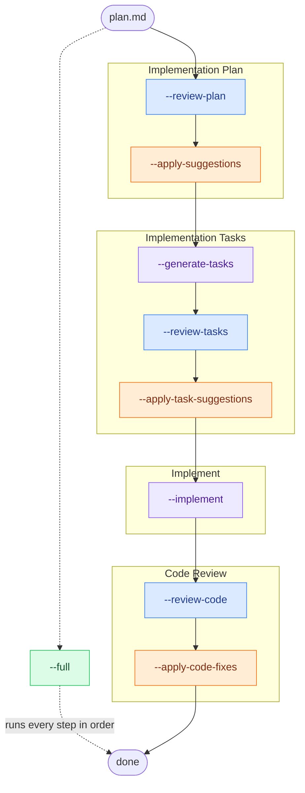

# multi-llm - Harness the harnesses


**Wisdom of crowds for your codebase.** Use this plugin to improve planning, implementation, and code review by running the same work through multiple AI coding tools and LLMs in parallel - then consolidating their feedback so you catch bugs, blind spots, and improvements a single model might miss.

The diversity works on two axes: not only do you get different **LLM models** (Opus, GPT, Gemini, Grok, Composer, ...), you also get different **code harnesses** (Codex, OpenCode, Cursor Agent, Gemini CLI, Grok Build, Cline, goose, Aider, Antigravity CLI, Pi, Muse Code, Kimi Code, Qwen Code, Copilot CLI, Mistral Vibe, oh-my-pi, ...) - each with its own prompting, tooling, and context-gathering behavior. Two harnesses running the *same* model can still surface different findings, so combining both axes widens the crowd further.

📺 **[Short video intro](https://www.youtube.com/watch?v=91lpnxAsyqs)** or **[Full video walkthrough](https://www.youtube.com/watch?v=_ySRt7rr0r8)** of the plugin in action.

Orchestrate **plan reviews, task generation, implementation, and code reviews across multiple LLM providers in parallel** - or ask every model the same free-text question about a plan and get one consolidated answer.

`multi-llm` fans a single workflow out to several CLI-based LLMs ([Cursor Agent](https://cursor.com/docs/cli/overview), [Gemini CLI](https://geminicli.com/docs/get-started/), [Grok Build](https://docs.x.ai/build), [Codex](https://developers.openai.com/codex/cli), [OpenCode](https://opencode.ai/docs/cli/), [Kilocode](https://kilo.ai/docs/cli), [Cline](https://docs.cline.bot/), [goose](https://block.github.io/goose/), [Aider](https://aider.chat/), [Antigravity CLI](https://antigravity.google/docs/cli/using), [Pi](https://pi.dev/docs/latest/usage), [Muse Code](https://dev.meta.ai/docs/muse-code/extending), [Kimi Code](https://code.kimi.com/docs), [Qwen Code](https://qwenlm.github.io/qwen-code-docs/), [GitHub Copilot CLI](https://docs.github.com/en/copilot/concepts/agents/about-copilot-cli), [Mistral Vibe](https://docs.mistral.ai/vibe/), [oh-my-pi](https://github.com/can1357/oh-my-pi), and [Claude Code](https://code.claude.com/docs/en/) itself), validates and consolidates their suggestions, and hands the host structured instructions to apply the results. The orchestrators never modify your code directly - they produce JSON that the host executes through its own tools, so every change stays reviewable.

It installs as a **Claude Code plugin**, and the same workflow runs inside **Codex** and **OpenCode** too - `install-host` writes a native entry point into either one: an OpenCode `/multi-llm` command, a Codex skill. See [docs/hosts.md](docs/hosts.md).

---

## Installation

### Claude Code (plugin)

In Claude Code:

```text
/plugin marketplace add beastlabai/multi-llm-plugin
/plugin install multi-llm@beastlabai
/reload-plugins
/reload-skills
/multi-llm:multi-llm --init
```

> **Already added the marketplace before (e.g. in another project)?** `/plugin marketplace add` does **not** refetch an existing marketplace - it silently reuses the locally cached copy, so `/plugin install` will give you a stale version. Follow [Updating the Claude Code plugin](#updating-the-claude-code-plugin) instead.

Then invoke the skill (plugin skills are namespaced `plugin:skill`):

```text
/multi-llm:multi-llm plans/my-feature.md
```

> Claude can also load the skill automatically when you ask it to "review my plan with multiple models", "run a multi-LLM code review", etc.

### Updating the Claude Code plugin

The marketplace cache only refreshes when you explicitly ask it to - `/plugin marketplace update` is the step that actually pulls the latest commits from GitHub. Then update (or install) the plugin and reload:

```text
/plugin marketplace update beastlabai
# remove "--scope local" if you installed it as user scope
! claude plugin update multi-llm@beastlabai --scope local
/reload-plugins
/reload-skills
/multi-llm:multi-llm --init --force
```

### Codex and OpenCode

This plugin also works with **Codex** and **OpenCode**. `install-host` writes a native entry point into either one: an OpenCode `/multi-llm` command, a Codex skill. Install, invocation, and host-specific differences are in **[docs/hosts.md](docs/hosts.md)**.

#### Codex plugin route

**Built, but not yet published.** The two commands below install multi-llm as a Codex plugin — a `multi_llm` tool plus a `multi-llm:multi-llm` skill that points at it, with no shell bootstrap and no baked path to go stale. The `release` ref they name does not exist until the first release is promoted, so today `--ref release` does not resolve and `codex plugin marketplace add` fails with a git error. **What works today is `install-host codex`** — the file route in [docs/hosts.md](docs/hosts.md).

Floors — published, not enforced, since nothing in the plugin checks them: **codex >= 0.156.1**, **python3 >= 3.9** on `PATH` under that exact name, and **uv** at any version.

```bash
codex --version                     # 0.156.1 or newer
python3 --version && uv --version   # python3 3.9 or newer, under these exact names
codex plugin marketplace add beastlabai/multi-llm-plugin --ref release \
  --sparse .agents --sparse packaging/codex
codex plugin add multi-llm@beastlabai
# then start a NEW session
```

Neither command installs dependencies: the first invocation builds the plugin's venv (`pyyaml` alone), which needs the network or a warm uv cache. Then, once per repository and in the new session, configure providers with *"Use the `multi-llm:multi-llm` skill with exactly these arguments: `--init`"* — it writes `<git-root>/.multi-llm/providers.yaml`, outside `$CODEX_HOME`, where no plugin reinstall or upgrade touches it. Configure through that file, never the copy installed inside the plugin.

**What it runs and what it may write — read this before the first command.** The tool starts the orchestrator from a server Codex launches *outside* its own exec sandbox, so the session's `--sandbox` posture does not govern it: installing the plugin gives a Codex session a write path it did not have. So under a read-only posture the tool **refuses write-capable modes** before it spawns anything, unless `MULTI_LLM_CODEX_UNSANDBOXED_WRITES=1` is in the environment that starts Codex. Provider CLIs the orchestrator dispatches stay under their own sandboxes. The install itself is a Git clone and a directory copy with no signature: you are trusting whoever can move the `release` ref and the workflow that moves it.

| Platform | Status | Prerequisites |
| --- | --- | --- |
| Linux | `verified` — the only platform this route claims | codex >= 0.156.1; `uv` and python3 >= 3.9 on `PATH` |
| macOS | `unmeasured` | codex >= 0.156.1; `uv` and python3 >= 3.9 on `PATH` (the command-line-tools `python3` is 3.9). Caveat: the run starts through a `bash -lc` login shell, which reads `~/.bash_profile` / `~/.profile` and **not** `~/.zprofile` or `~/.zshrc` — keys and `PATH` edits that live only in the zsh files never reach it |
| Windows | `unsupported for the tool route` — `python3` is usually absent under that name, so the plugin's server never starts and the tool never lists. Use `install-host codex` (the file route) instead | codex >= 0.156.1; `uv`; python3 >= 3.9 **under that exact name**; **plus Git Bash (or another POSIX `bash`) on `PATH` — a hard prerequisite**: without it the tool refuses with a missing-`bash` error naming the `PATH` it searched, rather than running without a login shell |

If the new session does not know the skill, or knows it and has no tool:

```bash
codex plugin list             # multi-llm@beastlabai — look at `enabled`; no entry means removed
codex mcp get multi_llm       # the server codex tried to start; python3 must be on PATH
python3 --version             # if this fails the server never started, and that is the whole story
```

`codex doctor` does not see plugin servers, so it will not help here.

**Provider keys go in the file your login shell reads.** Codex starts the plugin's server with a stripped environment, so a key exported only in the terminal you launched Codex from never reaches the run. Put `export OPENROUTER_API_KEY=…` (and whatever else your providers read) in `~/.profile` or `~/.bash_profile` — not `~/.bashrc`, and on macOS not `~/.zprofile`. Do not edit the installed `.mcp.json` to pass keys: the next `codex plugin add` replaces it wholesale. When a key does not arrive, the tool result's `environment` block (`login_shell`, `profile_shell`) says which startup file was read.

**Upgrade:** `codex plugin marketplace upgrade`, then `codex plugin add multi-llm@beastlabai`, then a new session — re-running the install's first command is a no-op on a marketplace already added. **Coming from the file route:** remove the shim with `install-host`'s counterpart, `uninstall-host codex --global`, or both skills stay advertised (`install-host codex --check` warns when they are). **Uninstall:** `codex plugin remove multi-llm@beastlabai`; your `.multi-llm/providers.yaml` is not touched. The plugin's own page is [`packaging/codex/README.md`](packaging/codex/README.md).

#### OpenCode npm route

**An npm route for OpenCode is built but not yet published.** `packaging/opencode/` produces `opencode-multi-llm`, which ships the skill tree inside the package and registers a model-callable `multi_llm` tool alongside the `/multi-llm` command — so there is no baked path to go stale and no `install-host --all` owed after an update. Until it is on npm, the way to run it is a local tarball:

```bash
make opencode-package                       # build, pack, sweep
# then add the .tgz path to opencode.json's "plugin" list and restart
```

Use `install-host opencode` for now: an `opencode.json` entry naming the unpublished spec resolves to nothing, and on that host the failure is silent — the plugin stays listed, the exit code is 0, and the debug log is empty. `packaging/opencode/README.md` is the package's own documentation.

### Configure providers (required before first use)

Edit [`skills/multi-llm/providers.yaml`](skills/multi-llm/providers.yaml) manually to match the code harnesses and models you want to use. The shipped file is a starting point only - keep the providers whose CLIs you have installed, remove the rest, and set `defaults.models` (and optionally `quick_models`) to the `provider:model` pairs you actually run. Without this step, default invocations will call harnesses or models you may not have configured. See [docs/providers.md](docs/providers.md) for the format and available keys.

> **Where is the file after installing via `/plugin`?** If you installed the plugin (rather than cloning this repo), `providers.yaml` lives inside the installed plugin, under your Claude Code plugin cache - `~/.claude/plugins/cache/<marketplace>/multi-llm/<version-or-commit>/skills/multi-llm/providers.yaml`, where the last segment changes on every update. The quickest way to open it is to ask Claude Code to "open the multi-llm `providers.yaml`": the skill resolves its own install location (via `${CLAUDE_SKILL_DIR}`), so Claude can read and edit the file in place.

### Prerequisites

| Requirement | Why |
| --- | --- |
| [`uv`](https://docs.astral.sh/uv/) on your `PATH` | The orchestrators run as `uv run` Python scripts. uv installs their dependencies (just `pyyaml`) on first use. If `uv` is missing when a mode starts (`--init`, `--review-plan`, `--review-code`, ...), the skill prints the installation instructions from `skills/multi-llm/hosts/uv-missing.txt` and stops (exit 3) — it never installs uv and never offers to. Install location and installer differ per OS: on **Linux/macOS** the official installer (`curl -LsSf https://astral.sh/uv/install.sh \| sh`) puts `uv` in `~/.local/bin/uv`; on **macOS** Homebrew installs to `/opt/homebrew/bin/uv` (Apple Silicon) or `/usr/local/bin/uv` (Intel), and MacPorts to `/opt/local/bin/uv`; on **Windows** the official installer is PowerShell (`powershell -ExecutionPolicy ByPass -c "irm https://astral.sh/uv/install.ps1 \| iex"`) and creates `%USERPROFILE%\.local\bin\uv.exe` — which Git Bash sees as `~/.local/bin/uv.exe` (note the `.exe`); `winget install --id=astral-sh.uv -e` and `pipx install uv` also work. |
| **Windows only:** [Git for Windows](https://git-scm.com/download/win) (Git Bash) | **Hard prerequisite on Windows.** The skill's entire instruction set and its permission (`allowed-tools`) rules are Bash-only; Claude Code's PowerShell-tool fallback (used when Git for Windows is absent) is explicitly **unsupported** — the skill fails fast with an install pointer rather than attempting PowerShell equivalents. Git for Windows also supplies the bundled coreutils the command blocks depend on (`ls`, `grep`, `diff`, `tail`, `dirname`, ...), which are absent from PowerShell/cmd. Note that `realpath` is *not* one of them: plan paths are passed to the orchestrators as-is (never wrapped in `$(realpath ...)`), and the orchestrators resolve them to OS-native absolute paths themselves. |
| One or more provider CLIs | You only need the CLIs for the models you actually run. See [docs/providers.md](docs/providers.md). |

The plugin ships its own `pyproject.toml`/`uv.lock`, so no manual Python setup is required - `uv` resolves the environment the first time a mode runs.

---

## Plans and outputs

A **plan** is just a markdown file describing the change you want to make - a feature spec, refactor outline, or design doc. You write it (or have Claude draft it), then point multi-llm at it. There's no required template; the more concrete the plan, the more useful the reviews. Most workflows start from a plan, with one exception: `--ask` only needs a plan to give the models context for your question.

The path you pass (e.g. `plans/my-feature.md`) is always a **file**. From it, multi-llm derives a sibling **output directory** in the same folder, named after the plan file without its extension - so `plans/my-feature.md` produces `plans/my-feature/`. All workflow state and generated artifacts live there:

| Path | Written by |
| --- | --- |
| `plans/my-feature/state.json` | every mode (tracks workflow progress) |
| `plans/my-feature/review-plan/` | `--review-plan`, `--apply-suggestions` |
| `plans/my-feature/tasks/` | `--generate-tasks`, `--review-tasks` |
| `plans/my-feature/implement/summary.md` | `--implement` |
| `plans/my-feature/code-review/report.md` | `--review-code`, `--apply-code-fixes` |
| `plans/my-feature/ask/<question-slug>/answers.md` | `--ask` |

Throughout this README and the linked docs, `{plan}/...` refers to that derived directory. Because everything is stored next to the plan, a workflow is fully portable - move or commit the plan folder and its state travels with it.

---

## Modes

Invoke with `/multi-llm:multi-llm [mode-flag] <plan_path> [options]` - on OpenCode the same command is `/multi-llm`, without the plugin namespace; on Codex the shim installs as a skill (model-invoked, not a slash command), so you ask for it by name instead (see [docs/hosts.md](docs/hosts.md)). With no mode flag, `--review-plan` is the default.

| Flag | What it does |
| --- | --- |
| `--review-plan` | Review an implementation plan with multiple LLMs (default) |
| `--apply-suggestions` | Apply validated review suggestions back into the plan |
| `--generate-tasks` | Generate detailed implementation tasks from a high-level plan |
| `--review-tasks` | Review generated tasks with multiple LLMs |
| `--apply-task-suggestions` | Apply validated task-review suggestions to `tasks.md` |
| `--implement` | Execute implementation tasks via subagent delegation |
| `--review-code` | Review code changes against the plan |
| `--apply-code-fixes` | Apply validated fixes from a code review |
| `--full` | Run the whole pipeline in sequence |
| `--status` | Show workflow state and the suggested next action |
| `--ask` | Ask each model a free-text question about a plan; aggregate the answers |

Two notes on the table above:

- **`--full`** chains the phases end to end: review-plan -> apply-suggestions -> generate-tasks -> review-tasks -> apply-task-suggestions -> implement -> review-code -> apply-code-fixes. It pauses at each apply step to let you approve `needs-human-decision` findings; pass `--yes` (alias `--non-interactive`) to run the whole pipeline fully unattended — zero prompts: non-interactive model selection, a subagent judges every `needs-human-decision` item, and review-tasks runs automatically. For finer control, add just `--no-confirm` and/or `--claude-decide` (see [below](#letting-claude-decide-ambiguous-findings)) instead.
- **Applying code fixes** can happen two ways. Run `--apply-code-fixes` as a standalone pass to apply a previous review's fixes - this is the phase that handles `needs-human-decision` items (prompts, salvage, HTML badges). Or, to apply only the clearly-valid fixes inline during the review itself, add `--apply-fixes` to a `--review-code` run.

### Pipeline flow

The mode flags are designed to run as an ordered pipeline (exactly what `--full` chains for you). Each **review** step fans the work out to multiple LLMs in parallel; each **apply** step is where the host writes the changes back and pauses for any `needs-human-decision` findings.



- 🔵 **Review** steps query multiple models in parallel 
- 🟠 **Apply** steps let the host write changes and pause for `needs-human-decision` items
- 🟣 **Generate & implement** steps produce tasks and write code
- 🟢 **`--full`** runs the entire flow with one command


You don't have to run the whole chain: **every step is also a standalone entry point** that reads/writes the shared `{plan}/state.json`, so you can start, stop, and resume at any phase. A few modes sit outside the pipeline - **`--ask`** (read-only Q&A about a plan), **`--status`** (show progress and the suggested next step), and **`--init`** (write a per-project config) - while **`--full`** simply runs the entire flow above end to end.

### Examples

```text
# Review a plan using the configured default LLMs
/multi-llm:multi-llm plans/my-feature.md

# Pick models explicitly, from several providers
/multi-llm:multi-llm --review-plan plans/my-feature.md --models codex:gpt-5.5-extra-high cursor-agent:composer-2.5

# Quick review (fewer, preselected subset of models)
/multi-llm:multi-llm --review-plan plans/my-feature.md --quick

# Review code changes against the plan
/multi-llm:multi-llm --review-code plans/my-feature.md

# Review/implement/code-review a plan using the configured default LLMs completely hands-off
/multi-llm:multi-llm --full plans/my-feature.md --claude-decide --non-interactive

# Ask every model the same question (read-only Q&A)
/multi-llm:multi-llm --ask plans/my-feature.md "Is the rollback strategy sufficient?"
```

### Options

These flags combine with any mode and are **position-independent** - they may appear before or after the plan path (and, for `--ask`, around the question). Not every flag applies to every mode.

| Flag | Effect |
| --- | --- |
| `--models <provider:model> ...` | Use exactly these models (variadic), overriding YAML defaults. Each must exist in `providers.yaml`. |
| `--quick` | Use the smaller `quick_models` subset for a faster  run. |
| `--interactive` | Force two-step model selection (provider, then models), ignoring YAML defaults. |
| `--no-confirm` | Skip confirmation prompts - for unattended/silent runs. |
| `--dry-run` | Show what would happen (tasks/batches) without making changes. Applies to `--implement` and the apply modes. |
| `--claude-decide` / `--let-claude-decide` | In the apply modes, let a subagent judge every `needs-human-decision` finding instead of prompting you (see [below](#letting-claude-decide-ambiguous-findings)). Implied by `--yes`, which the Codex and OpenCode shims bake in. |
| `--force` | **Meaning depends on mode.** In the fan-out review/ask modes (`--review-plan`, `--review-tasks`, `--review-code`, `--ask`), resume an interrupted run: keep already-completed per-model results, run only the missing models, and bypass the completed-phase / partial-completion guards. In the apply modes, it's an alias for `--yes` (confirm bulk approval). |
| `--rerun-all` | In the fan-out review/ask modes, re-run every model from scratch, discarding any existing per-model results. Combine with `--force` (`--force --rerun-all`) for a fresh full re-run of an already-completed phase. |

The apply and implement modes accept additional approval flags (`--yes`, `--approve-all`, `--resume`, `--task`, and more); run `multi_llm.py <mode> --help` for the authoritative list, or read the per-mode files in `skills/multi-llm/instructions/`.

### Letting Claude decide ambiguous findings

When the models disagree or a suggestion is borderline, validation marks it `needs-human-decision`. In the apply modes (`--apply-suggestions`, `--apply-code-fixes`, `--apply-task-suggestions`) Claude Code prompts you to approve or skip each one through its structured `AskUserQuestion` tool - it is the only host that has one, so on Codex and OpenCode the baked-in `--yes` resolves these without asking ([docs/hosts.md](docs/hosts.md)). Every such prompt also offers a **Let Claude decide** option, per item or for a whole batch, that hands just that judgment to a Claude subagent instead of you.

To skip the prompts entirely and have a subagent judge **every** `needs-human-decision` finding up front, pass `--claude-decide` (alias `--let-claude-decide`) - which is what the baked-in `--yes` already does on Codex and OpenCode:

```text
/multi-llm:multi-llm --apply-code-fixes plans/my-feature.md --claude-decide --no-confirm
```

Unlike the blanket approve/skip flags, "Let Claude decide" is a **per-item** judgment that **salvages** partially-valid findings - it trims each to its worthwhile core and applies that, skipping only findings with nothing worth keeping. The generated HTML report badges every finding **Approved / Salvaged / Skipped**. Add `--no-confirm` (as above) for a fully unattended run.

---

## Configuration

multi-llm calls the code harnesses and models you tell it to, in two layers:

| Layer | File | What it's for |
| --- | --- | --- |
| Base | `skills/multi-llm/providers.yaml`, inside the installed plugin | The provider/model catalog and the defaults every repo inherits. Edit it once, after installing. |
| Per-project | `<git-root>/.multi-llm/providers.yaml` - optional, auto-discovered | One repository's own defaults, without editing the installed plugin. Write it with `--init`. |

A model is referenced as `provider:model` (e.g. `codex:gpt-5.5`); a bare model name uses `default_provider`. Selection priority, highest first: `--models`, then `--interactive`, then `--quick`, then `defaults.models` from YAML, then interactive fallback.

- **[docs/providers.md](docs/providers.md)** - the provider table (every supported CLI, its binary, its measured quirks), `provider:model` naming, and how to point a provider CLI at a different endpoint (GLM / Z.ai worked recipes).
- **[docs/configuration.md](docs/configuration.md)** - the per-project override: what `--init` writes, layer precedence, list-replacement semantics, and why an auto-loaded override can never change *what executes*.

---

## How it works

- **Orchestrators emit instructions, not edits.** Each mode runs a Python orchestrator that queries the selected models in parallel, validates and consolidates their output, and prints structured instructions (and JSON) for the host to act on.
- **State is plan-local.** Workflow state lives in `{plan}/state.json` and all outputs are written next to the plan, so everything is portable and scoped to the plan it belongs to.
- **Relocatable paths.** The skill references its own bundled files through `${CLAUDE_SKILL_DIR}`, so it works wherever Claude Code installs the plugin; a shim installed into another host bakes the same directory in, which is why a plugin update needs one `install-host --all`.

The workflow contract lives in the host-neutral instruction core under [`skills/multi-llm/instructions/`](skills/multi-llm/instructions/); [`skills/multi-llm/SKILL.md`](skills/multi-llm/SKILL.md) is the Claude Code entry shim over it, [`docs/hosts.md`](docs/hosts.md) and [`skills/multi-llm/references/host-capabilities.md`](skills/multi-llm/references/host-capabilities.md) are the generated host documents, and [`skills/multi-llm/AGENTS.md`](skills/multi-llm/AGENTS.md) has the architecture notes.

---

## Your project repository

The repo where you run multi-llm workflows should include one or more `AGENTS.md` files - at the repo root and/or in subdirectories - with project-specific guidance for AI agents (conventions, architecture, pitfalls, etc.). `AGENTS.md` is supported by most code harnesses (Cursor, Codex, OpenCode, Gemini CLI, and others), so the external models multi-llm invokes pick up the same context.

To keep a single source of truth while still working with Claude Code, add a sibling `CLAUDE.md` that contains only:

```text
@AGENTS.md
```

Claude Code includes the referenced file automatically. This plugin follows that pattern in [`skills/multi-llm/AGENTS.md`](skills/multi-llm/AGENTS.md) and [`skills/multi-llm/CLAUDE.md`](skills/multi-llm/CLAUDE.md).

---

## Development

Tests, the containerized end-to-end harness (real provider CLIs against stubbed backends) and the plugin validator are documented in **[docs/development.md](docs/development.md)**.

```bash
uv run --project skills/multi-llm -- pytest   # the test suite, from the repo root
make e2e-container                            # containerized E2E, provider lane (needs Docker)
```

---

## Documentation

| Document | What's in it |
| --- | --- |
| [docs/providers.md](docs/providers.md) | Every supported harness CLI, `provider:model` naming, and endpoint recipes (GLM / Z.ai) |
| [docs/configuration.md](docs/configuration.md) | The per-project `.multi-llm/providers.yaml` override, layer precedence, and its safety model |
| [docs/hosts.md](docs/hosts.md) | Installing into Codex and OpenCode in full: paths, capability matrix, verification, uninstall |
| [docs/development.md](docs/development.md) | Test suite, the containerized E2E harness (Docker), and plugin validation |
| [docs/attribution.md](docs/attribution.md) | Trademark disclaimer, the one proprietary harness, and HTML-report brand marks |
| [`skills/multi-llm/AGENTS.md`](skills/multi-llm/AGENTS.md) | Architecture notes for anyone changing the skill itself |

---

## Roadmap

Planned improvements and open ideas are tracked in [`TODO.md`](TODO.md).

Contributions are welcome - pull requests, bug reports, feature suggestions, and documentation improvements. Open an issue to discuss a larger change before starting work, or send a PR directly for smaller fixes. See [docs/development.md](docs/development.md) for running tests locally.

---

## About BeastLab.ai

This plugin is maintained by [BeastLab.ai](https://beastlab.ai) - a frontier lab building multi-agent reasoning models.

**Disclaimer:** this plugin is provided as-is, with no warranties or liabilities of any kind, and BeastLab.ai is not affiliated with, endorsed by, or sponsored by any of the code harnesses or LLM providers it talks to. The full notice - including the one proprietary harness (GitHub Copilot CLI, used under its own EULA) and the provenance of the brand marks in HTML reports - is in [docs/attribution.md](docs/attribution.md).

---

## License

[MIT](LICENSE) © beastlabai
