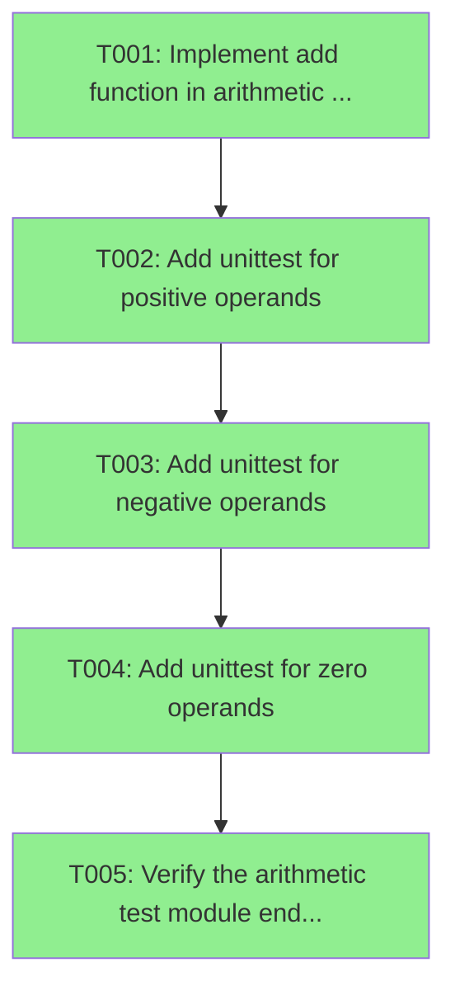

# Implementation Tasks for feature.md

*Generated: 2026-10-31 18:13:47*

**Parent Plan**: [feature.md](../feature.md)

---

## Dependency Graph

---

### Task T001: Implement add function in arithmetic module
**Dependencies**: None
**Files to modify**: none
**Files to create**: arithmetic.py
**Complexity**: low
**Executor**: agent

Create `arithmetic.py` at the repository root containing `def add(a, b):` that returns `a + b`, with no default arguments and no extra public names. Use only the Python standard library; the module needs no imports at all. Interface contract: `arithmetic.add(a, b)` is the public API consumed by the test tasks T002-T004, and its signature must not change afterwards.

**Acceptance Criteria**:
- [ ] `arithmetic.py` exists at the repository root and defines `def add(a, b):` with exactly two positional parameters and no defaults
- [ ] `python -c "import arithmetic; print(arithmetic.add(2, 3))"` prints `5`
- [ ] `grep -n import arithmetic.py` shows no imports, or only standard-library imports

---

### Task T002: Add unittest for positive operands
**Dependencies**: T001
**Files to modify**: none
**Files to create**: test_arithmetic.py
**Complexity**: low
**Executor**: agent

Create `test_arithmetic.py` at the repository root with `import unittest` and `from arithmetic import add`, plus a `unittest.TestCase` subclass (for example `TestAddPositive`) containing at least one test that asserts `add(1, 2) == 3` and `add(10, 20) == 30`. Do not add negative or zero cases yet; T003 and T004 extend this same file. Add an `if __name__ == '__main__': unittest.main()` guard.

**Acceptance Criteria**:
- [ ] `test_arithmetic.py` exists at the repository root and imports `add` from `arithmetic`
- [ ] `python -m unittest test_arithmetic.TestAddPositive` runs at least one test and reports `OK`
- [ ] The test file contains no assertions involving negative numbers or zero operands

---

### Task T003: Add unittest for negative operands
**Dependencies**: T002
**Files to modify**: test_arithmetic.py
**Files to create**: none
**Complexity**: low
**Executor**: agent

Extend `test_arithmetic.py` with a `unittest.TestCase` subclass (for example `TestAddNegative`) that asserts `add(-1, -2) == -3`, `add(-5, 3) == -2`, and `add(5, -3) == 2`. Keep the existing `TestAddPositive` class from T002 unchanged. Only edit `test_arithmetic.py`; `arithmetic.py` must not change.

**Acceptance Criteria**:
- [ ] `test_arithmetic.py` contains a class with assertions for `add(-1, -2)`, `add(-5, 3)`, and `add(5, -3)` with the expected results `-3`, `-2`, and `2`
- [ ] `python -m unittest test_arithmetic.TestAddNegative` reports `OK`
- [ ] `arithmetic.py` is unchanged compared with the T001 version, as shown by `git diff --stat -- arithmetic.py` producing no output

---

### Task T004: Add unittest for zero operands
**Dependencies**: T003
**Files to modify**: test_arithmetic.py
**Files to create**: none
**Complexity**: low
**Executor**: agent

Extend `test_arithmetic.py` with a `unittest.TestCase` subclass (for example `TestAddZero`) that asserts `add(0, 0) == 0`, `add(0, 7) == 7`, `add(7, 0) == 7`, and `add(0, -4) == -4`. Leave the classes from T002 and T003 unchanged. Only edit `test_arithmetic.py`.

**Acceptance Criteria**:
- [ ] `test_arithmetic.py` contains a class with assertions for `add(0, 0)`, `add(0, 7)`, `add(7, 0)`, and `add(0, -4)` with the expected results `0`, `7`, `7`, and `-4`
- [ ] `python -m unittest test_arithmetic.TestAddZero` reports `OK`
- [ ] The `TestAddPositive` and `TestAddNegative` classes still exist in `test_arithmetic.py` with their original assertions, as shown by `grep -c 'class TestAdd' test_arithmetic.py` printing `3`

---

### Task T005: Verify the arithmetic test module end to end
**Dependencies**: T004
**Files to modify**: none
**Files to create**: none
**Complexity**: low
**Executor**: agent

Run the full test module from the repository root with `python -m unittest -v test_arithmetic` and confirm that every test class from T002-T004 is discovered and passes. This task makes no file changes. If a failure shows that `add` is wrong, the fix belongs in `arithmetic.py` and is out of scope here, so report it instead of editing. Its only job is to confirm the feature as a whole.

**Acceptance Criteria**:
- [ ] `python -m unittest -v test_arithmetic` exits with status 0 and reports `OK`
- [ ] The verbose output lists tests from all three classes `TestAddPositive`, `TestAddNegative`, and `TestAddZero`
- [ ] `git status --porcelain -- arithmetic.py test_arithmetic.py` shows both files as present, with no other changes made by this task

---
